# Анализ наличия ресурсов базы данных Front

> Домашнее задание: анализ структуры legacy-базы `Front` (MS SQL Server 2017) перед миграцией на PostgreSQL.
> База восстановлена из бэкапа `rest.bak` в Docker-контейнер `mssql2017` (порт 1433), СУБД — MS SQL Server 2017.

## Общая характеристика базы

| Параметр | Значение |
|----------|----------|
| СУБД | MS SQL Server 2017 (контейнер `mssql2017`) |
| Количество таблиц | 235 |
| Период данных | 2002–2023 |
| Крупнейшие таблицы | `bm_Journal_Details` (1 089 641 строка), `bm_StorageOperations` (1 031 198), `journal` (225 681) |
| Объявленные внешние ключи | 75 (только у «новой» подсистемы `bm_*` и части справочников) |

Особенности legacy-структуры:

- База развивалась 15 лет: «старая» часть — таблицы без префикса (`journal`, `receiving`, `vendors`, `personnel`...), «новая» часть — таблицы с префиксом `bm_` (Barnet Front, добавлены в 2012–2014 гг.).
- Большинство связей между таблицами **не объявлены** через `FOREIGN KEY`. Связи восстановлены анализом имён и значений колонок и подтверждены SQL-запросами (см. разделы ниже).
- Многие справочники пустые (0 строк) — система мигрировала на аналоги из подсистемы `bm_*`.

---

## 1. Анализ закупки продукции (шаг: месяц)

### Вывод о наличии ресурсов

Данные по закупкам есть в трёх местах:

1. **`bm_StorageOperations`** — современная история складских операций (1 031 198 строк, ноябрь 2020 — декабрь 2023). Колонка `Period` хранит месяц в формате `YYYYMM` — идеально для анализа с шагом «месяц».
2. **`bm_JournalBarnetDocs`** — документы закупок (55 149 строк): приходные накладные («Поступление продуктов», тип 4), счета-фактуры.
3. **`receiving` / `orders`** — legacy-журнал закупок и заказов поставщикам (17 и 6 строк, 2002–2003 гг.) — исторические данные старой версии системы.

Справочники поставщиков (`vendors`, 63 записи), товаров (`product`, 1 545), складов (`storages`) заполнены. Ряд таблиц-настроек пуст: `ordervendorinfo`, `fob`, `conversion`, `conversionvendors` (0 строк) — в актуальной конфигурации не используются, но нужны для полноты схемы.

### Основные таблицы

| Таблица | Роль | Строк |
|---------|------|-------|
| `bm_StorageOperations` | Движения товаров по складу (факт закупок) | 1 031 198 |
| `bm_JournalBarnetDocs` | Документы (накладные, счета-фактуры) | 55 149 |
| `receiving` | Legacy-журнал приёмки товара | 17 |
| `orders` | Legacy-заказы поставщикам | 6 |
| `pricelist` | Закупочные прайс-листы поставщиков | 24 797 |

### Связанные таблицы

| Таблица | Роль |
|---------|------|
| `vendors` | Поставщик (63 записи) |
| `product` | Товар/номенклатура (1 545 записей) |
| `storages` | Склад (1 запись) |
| `bm_StorageOperationsType` | Тип операции: Поступление (+1), Списание (−1), Инвентаризация, Перемещение, Возврат |
| `bm_JournalType` | Журналы документов: 3 = «Складской учёт» |
| `bm_JournalTypeDocuments` | Типы документов: 4 = «Поступление продуктов» |
| `bm_Companies` | Юридическое лицо (контрагент), INN/KPP/OGRN |
| `ordervendorinfo` | Условия заказа у поставщика (мин. партия, кратность, закупочная цена) — 0 строк |
| `fob` | Условия поставки (FOB) — 0 строк |
| `conversion`, `conversionvendors` | Сопоставление кодов товаров/поставщиков при обмене — 0 строк |
| `category`, `size` | Категория товара и единица/фасовка |
| `pricegroup` | Группы цен (1 = «Закупочная», 2 = «Розничная») |

### Описание таблиц

#### bm_StorageOperations — движения товаров по складу

| Колонка | Назначение | Пример данных |
|---------|------------|---------------|
| `ID` | Первичный ключ операции | `4780421` |
| `DocumentID` | Ссылка на документ `bm_JournalBarnetDocs.ID` | `388235` |
| `OperationID` | Ссылка на тип операции `bm_StorageOperationsType.ID` | `1` (Поступление) |
| `ProductID` | Ссылка на товар `product.ID` | `4368` |
| `VendorID` | Ссылка на поставщика `vendors.ID` | `200` (ООО «Элит Трейд») |
| `StorageID` | Ссылка на склад `storages.ID` | `41` («Склад») |
| `RangeID` | Ссылка на единицу/фасовку `size.ID` | `42` |
| `Price`, `PriceCost` | Цена продажная / закупочная | `323.00`, `.00` |
| `Count` | Фактическое количество операции (поступления с плюсом, списания с минусом) | `2.7640` |
| `Quantity` | Заявленное количество (в данных не заполняется) | `.0000` |
| `Amount` | Сумма операции | `892.77` |
| `Rest` | Остаток после операции (в данных не заполняется) | `.0000` |
| `BatchID` | Номер партии | `0` |
| `Period` | Период (месяц) в формате `YYYYMM` — шаг анализа «месяц» | `202011` |
| `DateAdd` | Дата/время операции | `2020-11-15 14:15:30` |

#### bm_JournalBarnetDocs — документы (накладные, акты)

| Колонка | Назначение | Пример данных |
|---------|------------|---------------|
| `ID` | Первичный ключ документа | `1216` |
| `JournalID` | Ссылка на журнал `bm_JournalType.ID` | `3` (Складской учёт) |
| `ShiftID` | Ссылка на смену `bm_ShiftsOperations.ID` | `65` |
| `DocumentTypeID` | Тип документа `bm_JournalTypeDocuments.ID` | `4` (Поступление продуктов) |
| `CompanyID` | Контрагент `bm_Companies.ID` | `6` (ИП Лукьянова А.И., «Пиzzбург») |
| `DocumentNumber` | Номер документа | `1` |
| `Period` | Период документа | `2013-07-23 10:00:00` |
| `Amount`, `TaxedAmount` | Сумма документа, налоги | `.00`, `.00` |
| `PersonID` | Сотрудник, оформивший документ `personnel.personid` | `897` |
| `UserAdd`, `DateAdd` | Кто/когда создал | `userdb`, `2013-07-23 17:45:46` |

#### receiving — legacy-журнал приёмки товара (старая версия, 2002–2003)

| Колонка | Назначение | Пример данных |
|---------|------------|---------------|
| `storeid`, `posid` | Магазин и кассовый узел | `0`, `0` |
| `grouptranstype`, `transtype` | Группа и тип операции | `6`, `601` (приёмка) |
| `vendorid` | Поставщик (старая нумерация `vendors.id`) | `2` |
| `id`, `description` | Код и название товара | `807`, `GIN LIQ` |
| `quantity`, `price`, `amount` | Количество, цена, сумма | `50.000`, `10.00`, `500.00` |
| `cost` | Себестоимость | `.00` |
| `dateshipping`, `dater` | Дата отгрузки и приёмки | `2002-11-27`, `2002-11-25` |
| `ordern`, `transnumber` | Номер заказа и операции | `1`, `10` |

#### orders — legacy-заказы поставщикам

Состав колонок совпадает с `receiving` (заказ — «предварительная приёмка»). Дополнительные колонки:

| Колонка | Назначение | Пример данных |
|---------|------------|---------------|
| `orderquantity` | Заказанное количество | `NULL` |
| `bdlordern` | Номер заказа в связке | `NULL` |
| `multiple` | Кратность заказа | `NULL` |
| `bo` | Признак backorder | `NULL` |

#### pricelist — прайс-листы (закупочные цены поставщиков)

| Колонка | Назначение | Пример данных |
|---------|------------|---------------|
| `id` | Первичный ключ | `113681` |
| `vendorid` | Ссылка на поставщика `vendors.ID` | `NULL` |
| `productid` | Ссылка на товар `product.ID` | `4544` |
| `groupid` | Группа цен `pricegroup.pricegroupid` | `2` (Розничная) |
| `basecost` | Закупочная (базовая) стоимость | `140.00` |
| `netcost` | Чистая стоимость | `NULL` |
| `dateeff` | Дата вступления в силу | `NULL` |
| `country`, `distributor` | Страна, дистрибьютор | `NULL` |
| `status` | Статус строки прайса | `NULL` |

### Схема связей (ER-диаграмма)

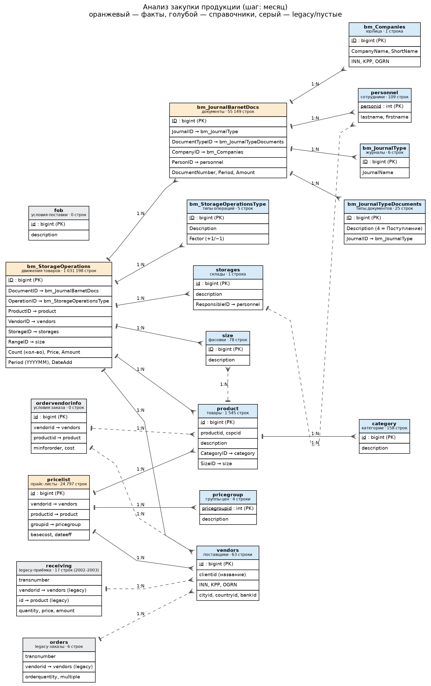

### Проверочные SQL-запросы

| Запрос | Файл | Результат |
|--------|------|-----------|
| Закупки по месяцам (шаг «месяц») | [SQL/01_purchases_monthly.sql](SQL/01_purchases_monthly.sql) | 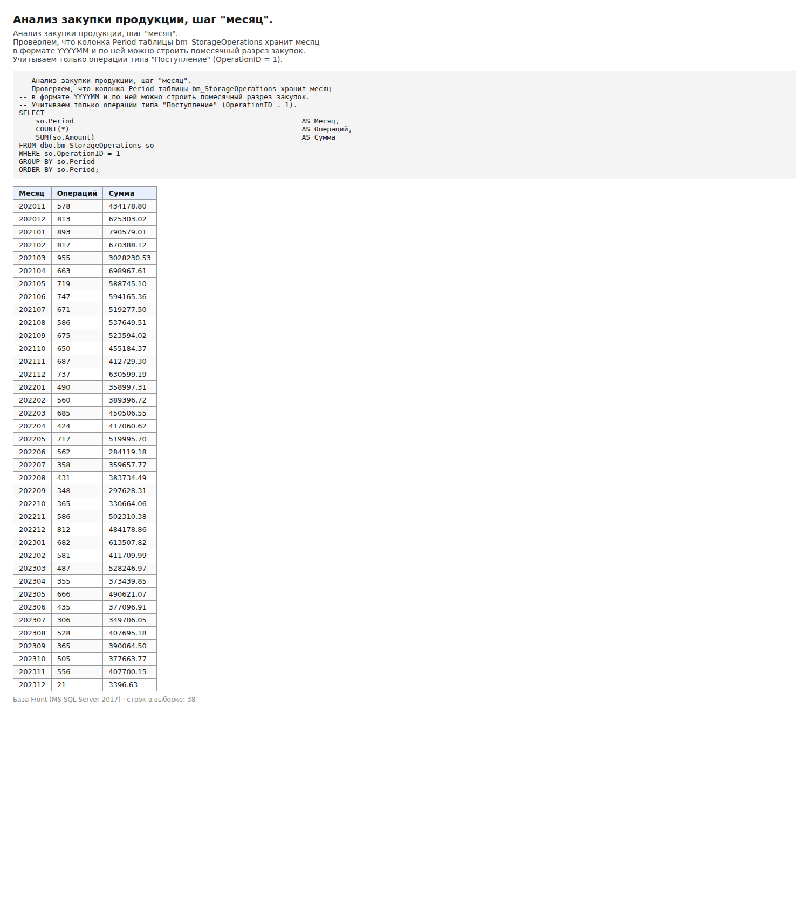 |
| Цепочка связей: документ → операция → товар → поставщик → склад | [SQL/01_purchases_links.sql](SQL/01_purchases_links.sql) | 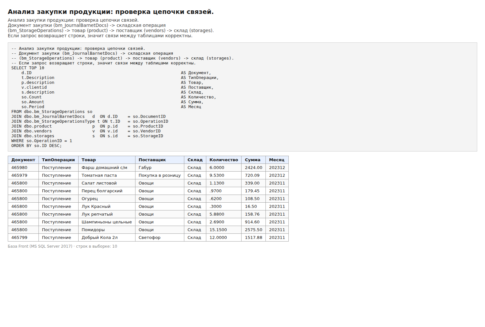 |

---

## 2. Анализ продажи товара (шаг: месяц)

### Вывод о наличии ресурсов

Продажи фиксируются в двух журналах:

1. **`journal`** — кассовый журнал (225 681 строка, 2012–2023): каждая строка — позиция/операция чека. Тип операции задаётся справочником `transtype` (`101` = PLU Sales — продажа). Кассир — `loginid` → `personnel.personid` (связь подтверждена: все 225 681 строки сопоставляются).
2. **`bm_Journal_Details`** — детализация заказов по товарам (1 089 641 строка): ссылка `SourceID` → `journal.transnumber`, `ProductID` → `product.ID`, `BludoID` → `product.ID` (блюдо), `RangeID` → `size.ID`.

Покупатели — `clients` (1 494) со скидочными группами `clientgroup` и `membership`. Цены — `pricegroup` (4 группы), наценки — `pricetypes` (пустая, 0 строк). Скидки — `discounts`/`discountgroup` (0 строк) и скидки в самом `journal.discount`. Подарочные карты — `giftcards` (15). `journalday` (сводка по дням) — 0 строк, `PreReceipt` (предварительные чеки/брони) — 10 767.

### Основные таблицы

| Таблица | Роль | Строк |
|---------|------|-------|
| `journal` | Кассовый журнал (чеки, все операции кассы) | 225 681 |
| `bm_Journal_Details` | Детализация продаж по товарам/блюдам | 1 089 641 |
| `PreReceipt` | Предварительные чеки (заказы на вынос, брони) | 10 767 |
| `journalday` | Сводка продаж по дням — 0 строк | 0 |

### Связанные таблицы

| Таблица | Роль |
|---------|------|
| `product` | Товар |
| `category` | Категория товара (158) |
| `size` | Единица/фасовка (78) |
| `transtype` | Тип операции кассы (81) |
| `personnel` | Кассир (loginid → personid) |
| `clients`, `clientgroup`, `membership` | Покупатели, группы, членство |
| `pricegroup`, `pricetypes` | Группы цен, типы цен/наценок |
| `discounts`, `discountgroup` | Скидки — 0 строк |
| `giftcards` | Подарочные карты (15) |
| `pos`, `stores` | Кассовые терминалы и магазины — 0 строк |
| `taxes` | Налоги (1 запись) |
| `bm_JournalBarnetDocs` | Финансовые документы продаж (тип 15 = «Реализация продукции», 6 = «Товарный чек») |

### Описание таблиц

#### journal — кассовый журнал

| Колонка | Назначение | Пример данных |
|---------|------------|---------------|
| `transnumber` | Первичный ключ операции (номер транзакции) | `1675588` |
| `storeid`, `posid`, `departmentid` | Магазин, кассовый узел, отдел | `0`, `0`, `0` |
| `transtype` | Тип операции `transtype.transtypeid` | `101` (PLU Sales) |
| `receiptn` | Номер чека | `59368651` |
| `cspcid` | Код товара в кассе | `271363` |
| `id`, `description` | Код и название товара (legacy) | `NULL`, `NULL` |
| `quantity`, `price`, `amount` | Количество, цена, сумма | `1.000`, `630.00`, `630.00` |
| `cost` | Себестоимость позиции | `.00` |
| `discount`, `discountamount` | Скидка (%) и сумма скидки | `.00`, `.00` |
| `tax1amount`...`tax4amount` | Налоги 1–4 | `.00` |
| `dater` | Дата/время операции | `2020-11-11 10:09:39` |
| `loginid` | Кассир `personnel.personid` | `906` |
| `customerid` | Покупатель `clients.clientid` | `NULL` |
| `flagrefund` | Признак возврата | `0` |
| `discountgroup` | Группа скидки `discountgroup.discountgroup` | `0` |
| `status` | Статус чека | `0` |

#### bm_Journal_Details — детализация продаж по товарам

| Колонка | Назначение | Пример данных |
|---------|------------|---------------|
| `SourceID` | Ссылка на операцию `journal.transnumber` | `1675591` |
| `ProductID` | Товар `product.ID` | `4407` |
| `BludoID` | Блюдо/комплект `product.ID` | `4451` |
| `RangeID` | Единица/фасовка `size.ID` | `42` |

#### PreReceipt — предварительные чеки (заказы на вынос, брони столов)

| Колонка | Назначение | Пример данных |
|---------|------------|---------------|
| `TransNumber` | Первичный ключ | `12345` |
| `ReceiptN` | Номер чека | `NULL` |
| `Phone`, `PhoneMail` | Телефон и e-mail клиента | `NULL` |
| `FIO` | ФИО гостя | `NULL` |
| `NumPersons` | Количество персон | `2` |
| `TakeOut` | Признак «на вынос» | `1` |
| `TimeReady` | Время готовности заказа | `NULL` |
| `DateR` | Дата заказа | `NULL` |
| `Comment` | Комментарий | `NULL` |

#### clients — покупатели

| Колонка | Назначение | Пример данных |
|---------|------------|---------------|
| `id` | Первичный ключ | `109` |
| `clientid` | Код клиента в кассе | `1234` |
| `lastname`, `firstname` | Фамилия, имя | `Самовывоз`, `Самовывоз` |
| `clientgroup` | Группа `clientgroup.clientgroupid` | `37` (Дсконт карты, скидка 5%) |
| `cityid` | Город `city.cityid` | `8` (Ангарск) |
| `points`, `bonus` | Накопленные баллы и бонусы | `0.00`, `0.00` |
| `membershipid` | Членство `membership.id` | `NULL` |
| `cardnumber` | Номер дисконтной карты | `NULL` |
| `personid` | Менеджер (сотрудник), закрепивший клиента | `0` |

#### pricegroup / pricetypes — цены

`pricegroup` — группы цен, к которым привязан товар (`product.pricegroupid`):

| Колонка | Назначение | Пример данных |
|---------|------------|---------------|
| `pricegroupid` | Первичный ключ | `1` |
| `description` | Название группы цен | `Закупочная` |
| `price1`...`price4` | Цены уровней 1–4 | `NULL` |
| `markup` | Наценка, % | `NULL` |
| `datestart` | Дата начала действия | `2012-12-24` |

`pricetypes` (типы цен с наценками) — 0 строк, справочник не заполнен.

### Схема связей (ER-диаграмма)

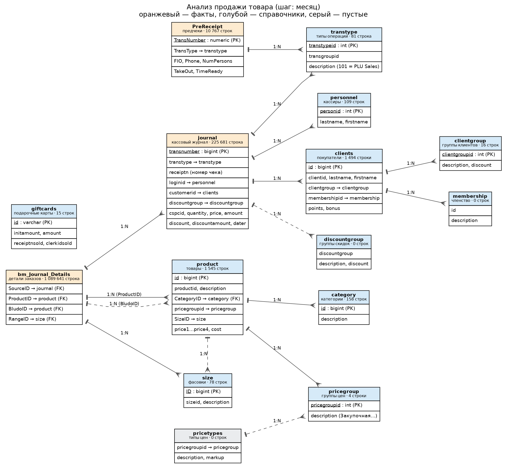

### Проверочные SQL-запросы

| Запрос | Файл | Результат |
|--------|------|-----------|
| Продажи по месяцам (шаг «месяц») | [SQL/02_sales_monthly.sql](SQL/02_sales_monthly.sql) | 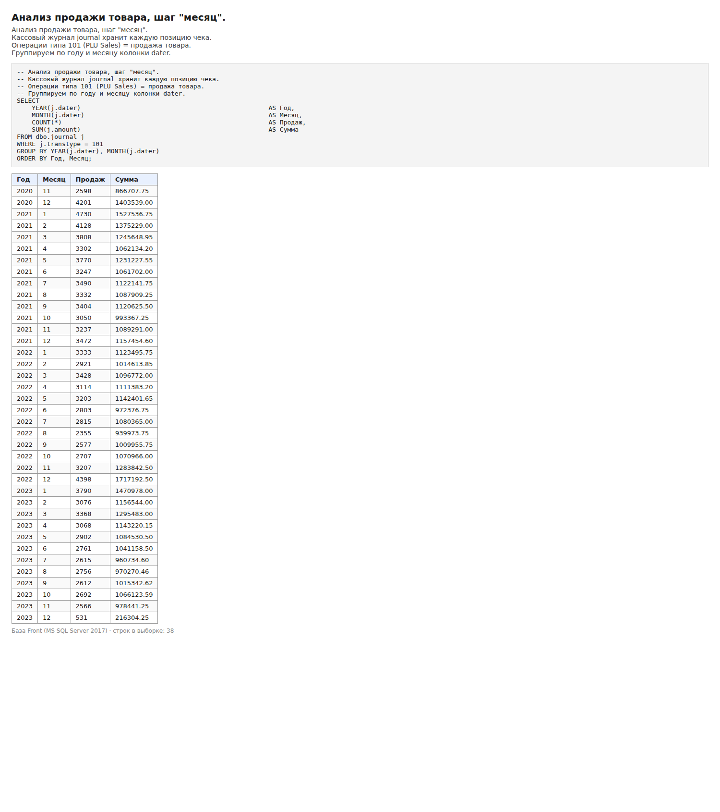 |
| Чек → кассир → тип операции (проверка связей) | [SQL/02_sales_links.sql](SQL/02_sales_links.sql) | 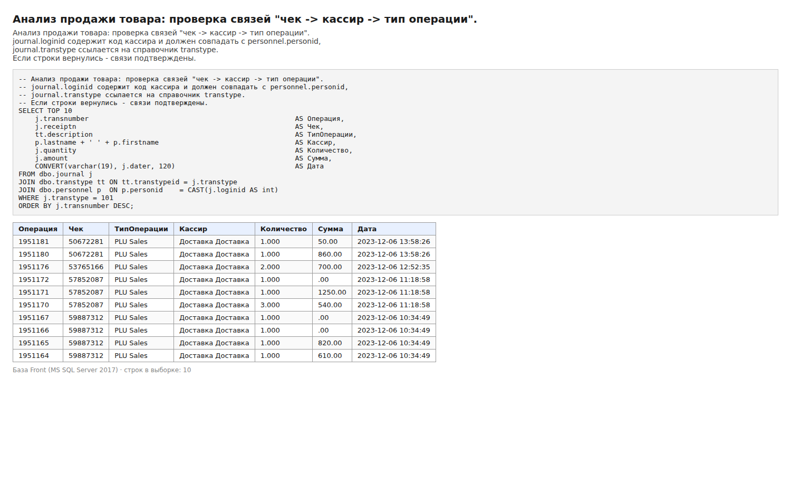 |
| Чек → товары → категории (через `bm_Journal_Details`) | [SQL/02_sales_details.sql](SQL/02_sales_details.sql) | 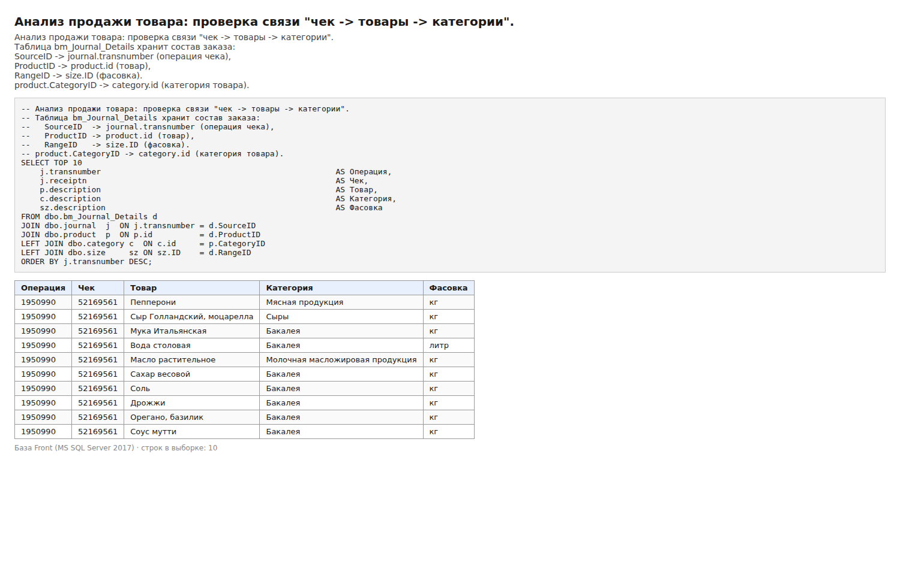 |

---

## 3. Анализ взаимоотношений с поставщиками (шаг: месяц)

### Вывод о наличии ресурсов

Центральная таблица — `vendors` (63 поставщика). Карточка поставщика содержит реквизиты: `INN`, `KPP`, `OGRN`, расчётный счёт (`accountn`), банк (`bankid` → `banks`), город (`cityid` → `city`), страну (`countryid` → `country`), группу (`clientgroup` → `vendorgroup`).

История взаимоотношений (объёмы закупок) — через `bm_StorageOperations.VendorID` (1 млн строк, шаг «месяц» по колонке `Period`). Прайс-листы поставщиков — `pricelist` (24 797 строк). Юридические лица-контрагенты — `bm_Companies` с `INN`/`KPP`/`OGRN`. Договоры — `bm_Contracts` (0 строк, структура есть). Условия заказа — `ordervendorinfo` (0 строк). Сопоставление кодов поставщиков при импорте прайсов — `conversionvendors` (0 строк).

### Основные таблицы

| Таблица | Роль | Строк |
|---------|------|-------|
| `vendors` | Поставщики | 63 |
| `bm_Companies` | Юридические лица (контрагенты) | 1 |
| `bm_Contracts` | Договоры с контрагентами — 0 строк | 0 |
| `ordervendorinfo` | Условия заказа у поставщика — 0 строк | 0 |
| `pricelist` | Прайс-листы поставщиков | 24 797 |
| `conversionvendors` | Сопоставление кодов поставщиков — 0 строк | 0 |

### Связанные таблицы

| Таблица | Роль |
|---------|------|
| `vendorgroup` | Группы поставщиков (2 записи) |
| `city`, `province`, `country`, `region` | География |
| `banks`, `bankinfo` | Банки и банковские выписки |
| `address` | Адреса контрагентов |
| `fob` | Условия поставки (FOB) — 0 строк |
| `product` | Поставляемые товары |
| `bm_StorageOperations` | История закупок по поставщику |
| `receiving`, `orders` | Legacy-документы закупок (поставщик в `vendorid`) |

### Описание таблиц

#### vendors — поставщики

| Колонка | Назначение | Пример данных |
|---------|------------|---------------|
| `id` | Первичный ключ | `200` |
| `clientid` | Название поставщика (в legacy хранится в clientid) | `ООО "Элит Трейд"` |
| `clientgroup` | Группа `vendorgroup.vendorgroupid` | `31` (Поставщики) |
| `lastname`, `firstname`, `contactperson` | Фамилия, имя, контактное лицо | `NULL`, `NULL`, `NULL` |
| `address` | Адрес | `NULL` |
| `cityid` | Город `city.cityid` | `8` (Ангарск) |
| `countryid` | Страна `country.id` | `10` (Россия) |
| `teln`, `fax`, `emaliaddress` | Телефон, факс, e-mail | `NULL` |
| `accountn` | Расчётный счёт | `NULL` |
| `bankid` | Банк `banks.id` | `NULL` |
| `INN`, `KPP`, `OGRN` | Реквизиты юрлица | `NULL` |
| `discount`, `bonus` | Скидка и бонус от поставщика | `0.00`, `0.00` |
| `IsUse` | Признак использования | `1` |

#### bm_Companies — юридические лица (контрагенты)

| Колонка | Назначение | Пример данных |
|---------|------------|---------------|
| `ID` | Первичный ключ | `6` |
| `CompanyName` | Полное наименование | `ИП Лукьянова Анастасия Игоревна` |
| `ShortName` | Краткое наименование | `Пиzzбург` |
| `INN`, `KPP`, `OGRN` | Реквизиты | `380122679974`, `NULL`, `320385000078976` |
| `CityID`, `Address` | Город, адрес | `NULL`, `NULL` |
| `DirectorMen`, `CalculatorMen`, `ProductionMen`, `AccountMen` | Руководитель, расчётчик, производство, бухгалтер | `NULL` |
| `IsUse` | Признак использования | `1` |

#### bm_Contracts — договоры

| Колонка | Назначение | Пример данных |
|---------|------------|---------------|
| `ID` | Первичный ключ | — (0 строк) |
| `CompanyID` | Контрагент `bm_Companies.ID` | — |
| `VendorID` | Поставщик `vendors.ID` | — |
| `ContractNumber` | Номер договора | — |
| `Period` | Период действия | — |

#### ordervendorinfo — условия заказа у поставщика

| Колонка | Назначение | Пример данных |
|---------|------------|---------------|
| `id` | Первичный ключ | — (0 строк) |
| `vendorid` | Поставщик `vendors.ID` | — |
| `productid` | Товар `product.productid` | — |
| `minfororder` | Минимальная партия заказа | — |
| `multiplefororder` | Кратность заказа | — |
| `cost` | Закупочная цена | — |
| `unitofmeasure`, `vendorunitofmeasure` | Единицы измерения (наши/поставщика) | — |

#### banks / bankinfo — банки

| Колонка | Назначение | Пример данных |
|---------|------------|---------------|
| `id` | БИК банка | `042504720` |
| `description` | Наименование банка | `АКБ "БРАТСКГЭССТРОЙ"` |
| `account` | Корр. счёт | `30101810900000000720` |
| `mfo` | МФО | `NULL` |

`bankinfo` (движения по счетам) — 0 строк: колонки `id`, `dater`, `accountid`, `paymenttype`, `amount`.

### Схема связей (ER-диаграмма)

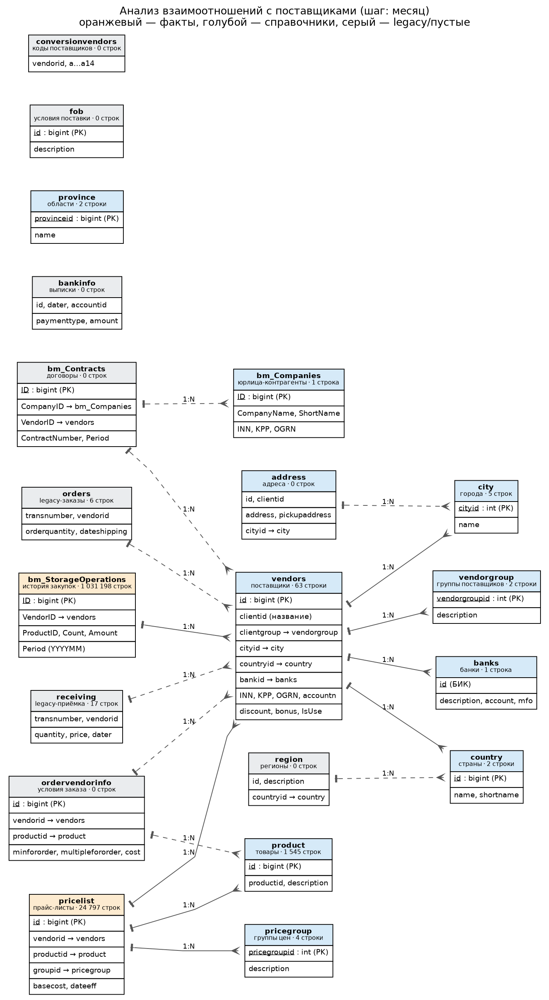

### Проверочные SQL-запросы

| Запрос | Файл | Результат |
|--------|------|-----------|
| Карточка поставщика: группа, город, страна | [SQL/03_vendors_card.sql](SQL/03_vendors_card.sql) | 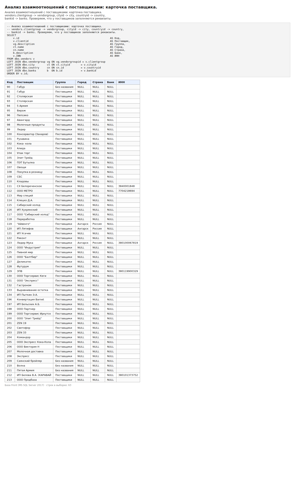 |
| Объёмы закупок по поставщикам по месяцам | [SQL/03_vendors_purchases.sql](SQL/03_vendors_purchases.sql) | 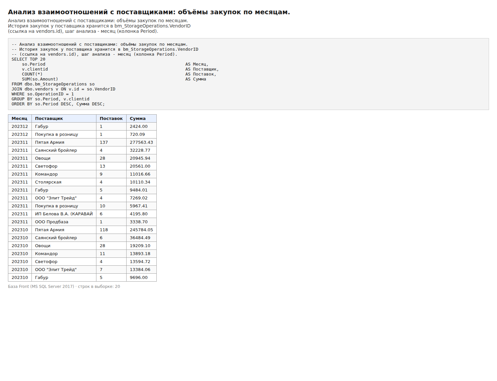 |
| Прайс-лист: поставщик → товар → группа цен | [SQL/03_vendors_pricelist.sql](SQL/03_vendors_pricelist.sql) | 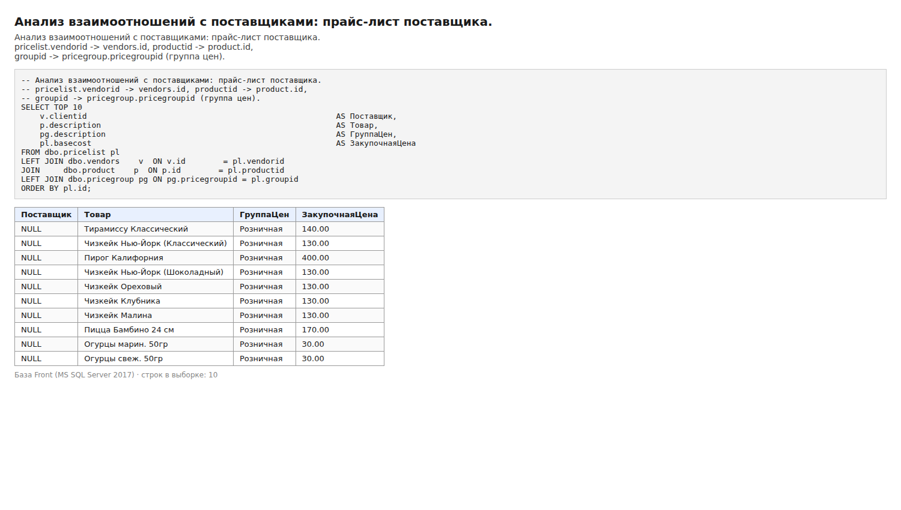 |

---

## 4. Анализ работы персонала (шаг: полгода, квартал)

### Вывод о наличии ресурсов

Персонал — таблица `personnel` (109 сотрудников). Каждый сотрудник имеет уровень доступа `securityaccess` (Clerk, Manager/Adm, Special Access, Bartender) и набор прав (`flagpos` — касса, `flagsales` — продажи, `flagrefunds` — возвраты, `flagdiscounts` — скидки, `flagreports` — отчёты и т.д.).

Активность персонала фиксируется в:

- `journal` — кассовый журнал: каждая операция помечена `loginid` = `personnel.personid` (все 225 681 строк сопоставляются). Есть служебные типы операций: `301` Login, `305` The End of Day, `386` Начало работы, `387` Окончание работы, `723` Завершение рабочего дня.
- `bm_JournalBarnetDocs` — документы, оформленные сотрудником (`PersonID`), 55 149 строк.
- `bm_JournalSessions` — системный журнал сессий (174 072 записи, `PersonID`).
- `bm_BonusHistory` — начисленные бонусы с указанием кассира (`PersonID`), 44 866 строк.
- `bm_ShiftsOperations` / `bm_ShiftsOperations_Values` — смены и показатели смен (1 запись / 0 строк).
- `personnelmessages` — внутренние сообщения между сотрудниками (0 строк).
- `closingcount` — пересчёт остатков при закрытии смены (0 строк; ссылки `storeid` → `environment`, `productid` → `product`).

### Основные таблицы

| Таблица | Роль | Строк |
|---------|------|-------|
| `personnel` | Сотрудники | 109 |
| `journal` | Кассовые операции сотрудника (loginid) | 225 681 |
| `bm_JournalSessions` | Журнал сессий системы (PersonID) | 174 072 |
| `bm_JournalBarnetDocs` | Документы, оформленные сотрудником (PersonID) | 55 149 |
| `bm_ShiftsOperations`, `bm_ShiftsOperations_Values` | Смены и показатели смен | 1 / 0 |

### Связанные таблицы

| Таблица | Роль |
|---------|------|
| `bm_BonusHistory` | Бонусы, начисленные сотрудником (PersonID) |
| `securityaccess` | Уровни доступа |
| `city` | Город сотрудника |
| `personnelmessages` | Сообщения между сотрудниками — 0 строк |
| `closingcount`, `addclosingcount` | Пересчёт при закрытии смены — 0 строк |
| `environment` | Окружение (настройки сбора/тары), `closingcount.storeid` |
| `stores` | Точка работы — 0 строк |

### Описание таблиц

#### personnel — сотрудники

| Колонка | Назначение | Пример данных |
|---------|------------|---------------|
| `personid` | Первичный ключ (он же логин кассира) | `906` |
| `lastname`, `firstname`, `middlename` | Фамилия, имя, отчество | `Безик`, `Татьяна`, `NULL` |
| `address`, `cityid` | Адрес и город `city.cityid` | `NULL` |
| `teln`, `emaliaddress` | Телефон, e-mail | `NULL` |
| `password` | Пароль входа | `NULL` |
| `securityaccess` | Уровень доступа `securityaccess.securityaccessid` | `9` (Special Access) |
| `flagpos` | Право работы с кассой | `1` |
| `flagsales` | Право продаж | `0` |
| `flagrefunds` | Право возвратов | `NULL` |
| `flagdiscounts` | Право давать скидки | `NULL` |
| `flagreports` | Право смотреть отчёты | `NULL` |
| `flagtraining` | Режим обучения | `NULL` |
| `cashdrawer` | Доступ к денежному ящику | `NULL` |
| `bartender` | Признак бармена | `NULL` |
| `deleteflag` | Признак удаления | `NULL` |
| `comments` | Комментарий | `NULL` |

#### securityaccess — уровни доступа

| Колонка | Назначение | Пример данных |
|---------|------------|---------------|
| `securityaccessid` | Первичный ключ | `3` |
| `description` | Название уровня | `Manager/Adm` |

#### bm_JournalSessions — журнал сессий (действия сотрудников в системе)

| Колонка | Назначение | Пример данных |
|---------|------------|---------------|
| `ID` | Первичный ключ | `174070` |
| `Type` | Источник события | `ЕГАИС` |
| `Message` | Текст события | `Включен режим автоматической проверки...` |
| `IsError` | Признак ошибки | `0` |
| `DateAdd` | Дата/время события | `2023-12-06 14:18:07` |
| `UserAdd` | Пользователь | `userdb` |
| `PersonID` | Сотрудник `personnel.personid` | `897` |

#### bm_BonusHistory — начисление бонусов клиентам

| Колонка | Назначение | Пример данных |
|---------|------------|---------------|
| `ID` | Первичный ключ | `84860` |
| `ClientID` | Покупатель `clients.id` | `255` |
| `ActionName` | Действие | `Journal` |
| `BonusValue` | Сумма бонусов | `13542789.74` |
| `Period` | Дата начисления | `2023-12-06 10:31:54` |
| `TicketNumber` | Номер чека | `59368651` |
| `PersonID` | Сотрудник, выполнивший операцию | `906` |
| `IsCalc` | Признак расчёта | `1` |

#### bm_ShiftsOperations — смены

| Колонка | Назначение | Пример данных |
|---------|------------|---------------|
| `ID` | Первичный ключ | `65` |
| `ShiftNumber` | Номер смены | `1` |
| `Amount` | Итог смены | `.00` |
| `DateAdd` | Дата смены | `2015-07-14 10:29:13` |
| `UserAdd` | Пользователь | `sa` |
| `PersonalID` | Сотрудник `personnel.personid` | `0` |
| `CompanyID` | Компания `bm_Companies.ID` | `6` |

### Схема связей (ER-диаграмма)

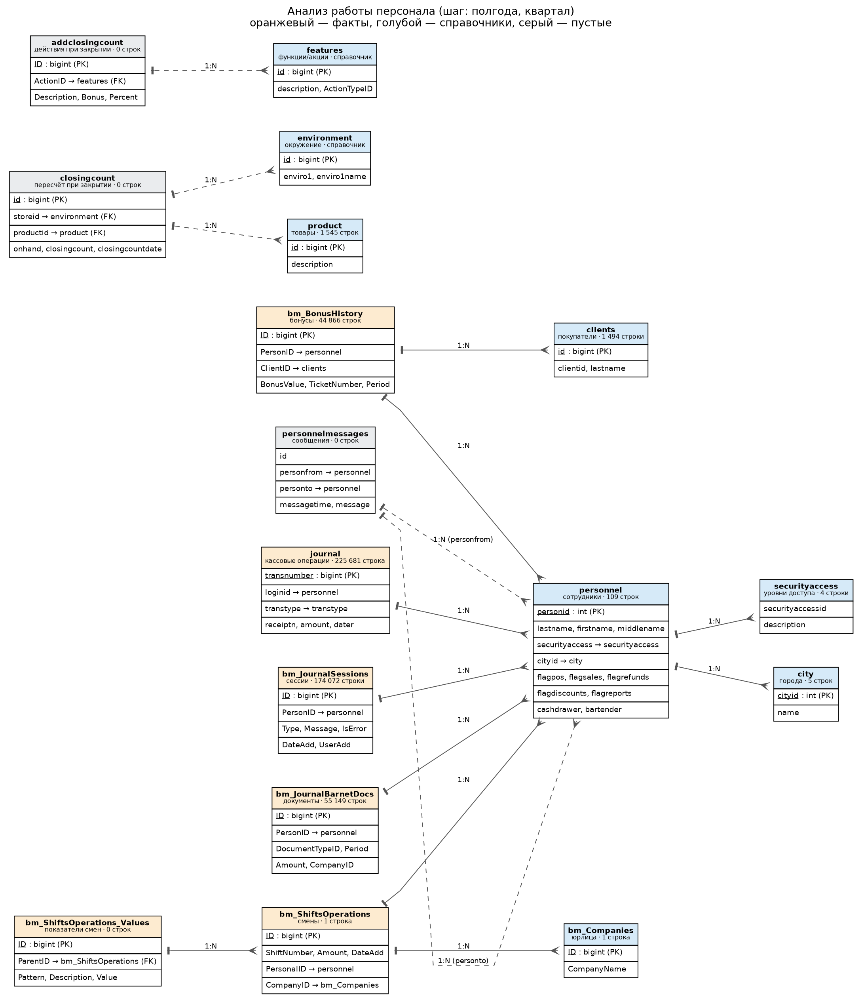

### Проверочные SQL-запросы

| Запрос | Файл | Результат |
|--------|------|-----------|
| Активность сотрудников по кварталам (шаг «квартал») | [SQL/04_personnel_quarters.sql](SQL/04_personnel_quarters.sql) | 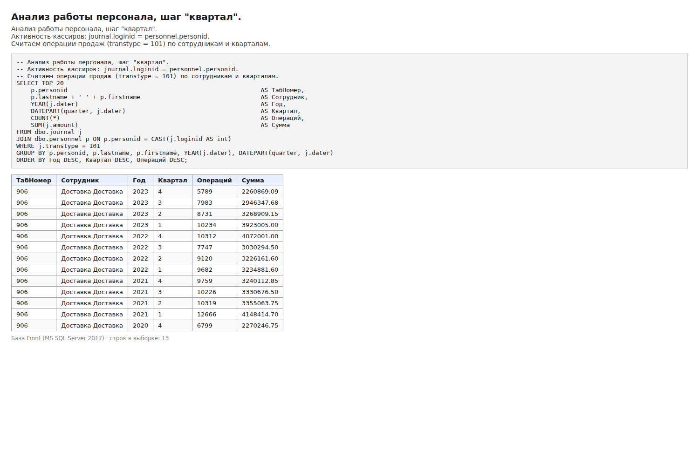 |
| Документы, оформленные сотрудником (проверка связи) | [SQL/04_personnel_docs.sql](SQL/04_personnel_docs.sql) | 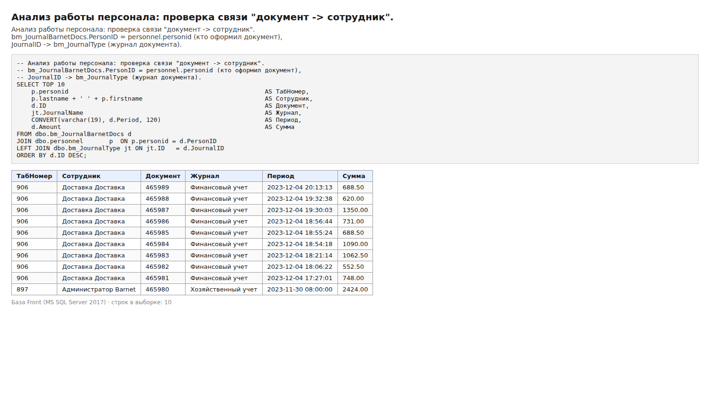 |
| Бонусы по сотрудникам (проверка связи) | [SQL/04_personnel_bonus.sql](SQL/04_personnel_bonus.sql) | 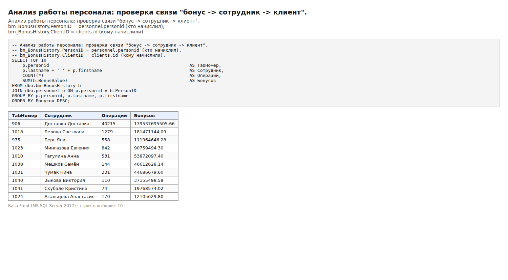 |

---

## 5. Анализ остатков (шаг: одна неделя)

### Вывод о наличии ресурсов

Классические таблицы остатков старой версии **пустые**: `stock` (0), `onhand` (0), `storagesonhand` (0), `stockcounter` (0), `closingcount` (0), `keg` (0). Их структура сохранилась, но актуальные данные остатков находятся в подсистеме Barnet:

- **`bm_StorageOperations`** (1 031 198 строк) — журнал всех движений: Поступление (+1), Списание (−1), Инвентаризация, Перемещение, Возврат. Остаток по товару/складу восстанавливается суммированием `Quantity` с учётом коэффициента `bm_StorageOperationsType.Factor` за любой период (в т.ч. неделю — по колонке `DateAdd`).
- **`bm_StorageOperations_Table`** (30 801 строка) — детали движений (списания по рецептам, возвраты) со ссылками на товар, склад, документ.
- `storages` — справочник складов (1 склад).
- `beginperiod` (23 записи) — точки начала периодов учёта (точки «нулевого» остатка), от которых считается накопленный остаток.
- `stockperiod` (56 строк) — диапазоны цен по объёму закупки (пороговые количества и цены), используются в закупках/ценообразовании, а не для хранения остатков.
- `closingcount` — пересчёт остатков при закрытии (структура готова, 0 строк).

### Основные таблицы

| Таблица | Роль | Строк |
|---------|------|-------|
| `bm_StorageOperations` | Движения товаров (основа расчёта остатков) | 1 031 198 |
| `bm_StorageOperations_Table` | Детали движений | 30 801 |
| `stock` | Текущие остатки по товарам — 0 строк | 0 |
| `storagesonhand`, `onhand` | Остатки по складам — 0 строк | 0 |
| `stockcounter` | Пересчёты (инвентаризация) — 0 строк | 0 |
| `keg` | Учёт разливных напитков (кеги) — 0 строк | 0 |

### Связанные таблицы

| Таблица | Роль |
|---------|------|
| `product` | Товар |
| `size` | Единица/фасовка |
| `storages` | Склады |
| `vendors` | Поставщик |
| `bm_StorageOperationsType` | Типы операций с коэффициентами (+1/−1) |
| `bm_JournalBarnetDocs` | Документы-основания движений |
| `beginperiod` | Начало периодов учёта (23) |
| `stockperiod` | Ценовые диапазоны по объёму (56) |
| `closingcount` | Пересчёт при закрытии — 0 строк |
| `environment` | Окружение (`closingcount.storeid`) |

### Описание таблиц

#### bm_StorageOperations — движения товаров (повторно, ключевая для остатков)

См. раздел 1. Для остатков важны колонки: `ProductID`, `StorageID`, `OperationID`, `Count` (фактическое количество, поступления с плюсом, списания с минусом), `Amount`, `DateAdd`. Остаток по товару восстанавливается суммированием `Count` по всем операциям.

#### bm_StorageOperations_Table — детали движений (списания, возвраты)

| Колонка | Назначение | Пример данных |
|---------|------------|---------------|
| `ID` | Первичный ключ | `134198` |
| `DocumentID` | Документ `bm_JournalBarnetDocs.ID` | `388540` |
| `OperationID` | Тип операции `bm_StorageOperationsType.ID` | `2` (Списание) |
| `StorageID` | Склад `storages.ID` | `41` |
| `SourceID` | Исходная операция (кассовая) | `200634` |
| `BludoID` | Блюдо `product.ID` | `4641` |
| `ProductID` | Товар `product.ID` | `4345` |
| `RangeID` | Единица `size.ID` | `42` |
| `Quantity`, `Count`, `Rest`, `Amount` | Заявленное кол-во, фактическое кол-во, остаток, сумма | `.0000`, `.0000`, `.0000`, `.0000` |
| `ClientID` | Покупатель | `0` |
| `ReasonID` | Причина списания | `24` |
| `DateAdd` | Дата/время | `2020-11-15 18:05:37` |

#### stock — текущие остатки (legacy, не заполняется)

| Колонка | Назначение | Пример данных |
|---------|------------|---------------|
| `cspcid` | Код товара в кассе | — (0 строк) |
| `productid` | Товар `product.productid` | — |
| `storageid` | Склад `storages.id` | — |
| `quantity`, `amount` | Остаток (количество и сумма) | — |
| `onhand` | Остаток на руках | — |
| `openedq`, `receivedq`, `soldq`, `closedq` | Открыто/получено/продано/закрыто за период | — |
| `lastsold`, `lastreceived` | Даты последней продажи/приёмки | — |
| `newbasecost`, `basecost` | Текущая и базовая себестоимость | — |

#### beginperiod — начало периодов учёта остатков

| Колонка | Назначение | Пример данных |
|---------|------------|---------------|
| `id` | Первичный ключ | `17` |
| `datestart` | Дата начала периода (точка отсчёта остатка) | `2009-03-17 11:00:00` |

#### stockcounter — пересчёт/инвентаризация (legacy, не заполняется)

| Колонка | Назначение | Пример данных |
|---------|------------|---------------|
| `id` | Первичный ключ | — (0 строк) |
| `productid` | Товар | — |
| `vendorid` | Поставщик | — |
| `price`, `quantity`, `amount` | Цена, факт. количество, сумма | — |
| `shortq`, `shorta` | Недостача (количество и сумма) | — |
| `dater` | Дата пересчёта | — |

#### storages — склады

| Колонка | Назначение | Пример данных |
|---------|------------|---------------|
| `id` | Первичный ключ | `41` |
| `description` | Название склада | `Склад` |
| `CompanyID` | Компания `bm_Companies.ID` | `6` |
| `CityID`, `Address` | Город и адрес | `NULL` |
| `ResponsibleID` | Материально ответственный `personnel.personid` | `897` |

### Схема связей (ER-диаграмма)

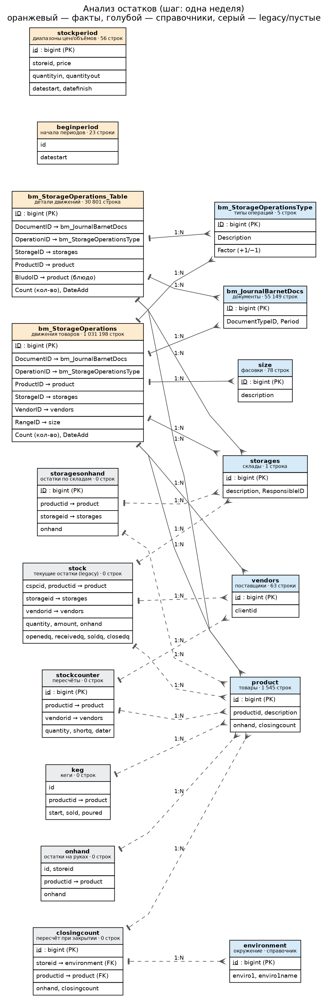

### Проверочные SQL-запросы

| Запрос | Файл | Результат |
|--------|------|-----------|
| Остаток по товару на конец недели (шаг «неделя») | [SQL/05_stock_weekly.sql](SQL/05_stock_weekly.sql) | 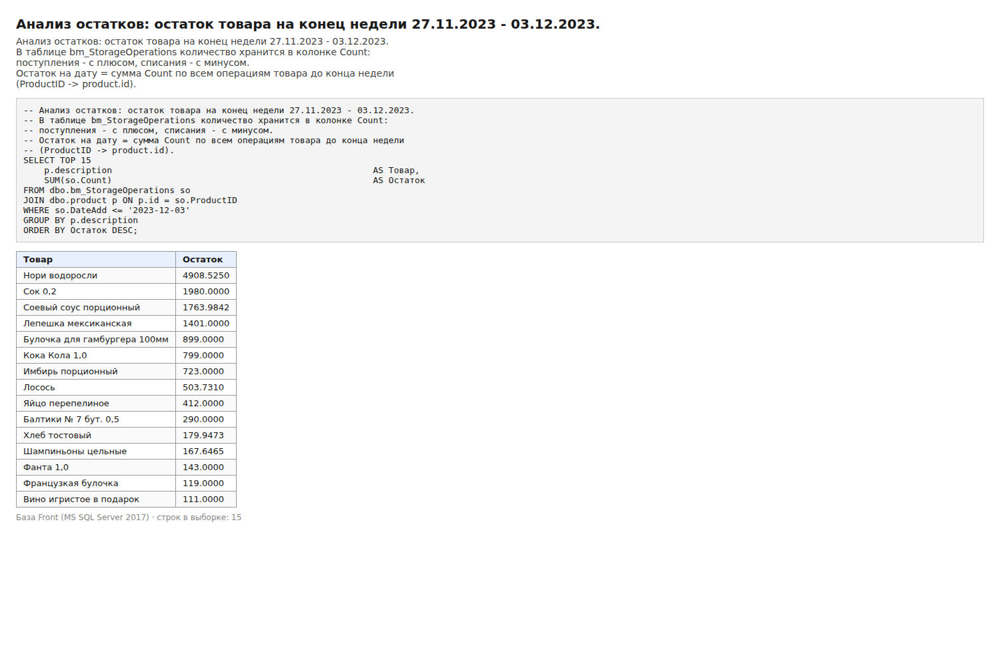 |
| Движения по складу за неделю (проверка связей) | [SQL/05_stock_moves.sql](SQL/05_stock_moves.sql) | 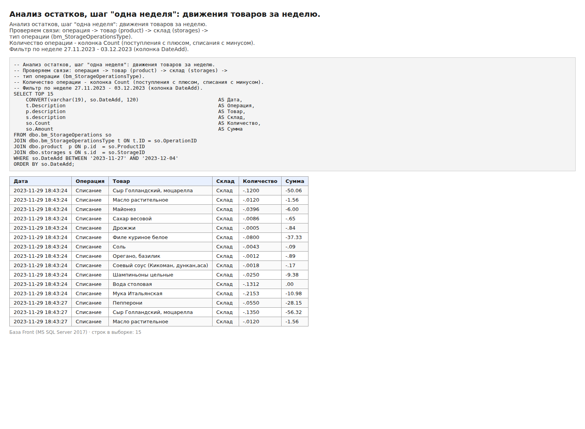 |

---

## Итоговый вывод о наличии ресурсов

| Направление | Данные есть? | Основной источник | Период |
|-------------|--------------|-------------------|--------|
| Закупки продукции | ✅ | `bm_StorageOperations` + `bm_JournalBarnetDocs` | 2020–2023 (+ legacy 2002–2003) |
| Продажи товара | ✅ | `journal` + `bm_Journal_Details` | 2012–2023 |
| Взаимоотношения с поставщиками | ✅ (справочники), частично (история) | `vendors` + `bm_StorageOperations` | 2020–2023 |
| Работа персонала | ✅ | `personnel` + `journal` + `bm_JournalBarnetDocs` | 2012–2023 |
| Остатки | ✅ (восстанавливаются из движений) | `bm_StorageOperations` | 2020–2023 |

Для всех пяти направлений ресурсов достаточно: факты операций и справочники заполнены. Legacy-таблицы (`receiving`, `orders`, `stock`, `onhand`, `stockcounter`, `closingcount`, `ordervendorinfo`, `fob`) имеют структуру, но не используются в актуальном учёте — при миграции их данные переносятся «как есть», а расчёт витрин OLAP строится на таблицах подсистемы `bm_*`.
