# Анализ базы данных Front

## 1. Закупка продукции (шаг: месяц)

**основные:** bm_StorageOperations, bm_JournalBarnetDocs
**связанные:** product, vendors, storages, bm_StorageOperationsType, bm_JournalTypeDocuments, bm_StorageOperations_Table, pricelist

**bm_StorageOperations** — главная таблица: в ней сами операции — сколько товара пришло, от какого поставщика. Колонка Period = месяц (YYYYMM), по ней и считаем закупки.

- DocumentID — ссылка на документ, например `388235`
- ProductID — товар, например `4368`
- VendorID — поставщик, например `200` (ООО «Элит Трейд»)
- StorageID — склад, например `41` («Склад»)
- Count — количество, например `2.7640`
- Amount — сумма, например `892.77`

**bm_JournalBarnetDocs** — сам документ (приходная накладная):

- ID — ключ, например `1216`
- DocumentTypeID — тип документа, `4` = «Поступление продуктов»
- Period — дата, например `2023-11-11`

**bm_StorageOperations_Table** — детали операций, почти все строки (30 800 из 30 801) — это списания ингредиентов по составу блюд.

**Как связаны:** один документ → много операций, один товар → много операций, один поставщик → много операций. Нюанс: VendorID заполнен только у поступлений, у списаний он 0.

**SQL: цепочка связей**

```sql
select top 10
	d.ID as "Документ",
	t.Description as "Тип операции",
	p.description as "Товар",
	v.clientid as "Поставщик",
	s.description as "Склад",
	so.Count as "Количество",
	so.Amount as "Сумма",
	so.Period as "Месяц"
from dbo.bm_StorageOperations so
join dbo.bm_JournalBarnetDocs d on d.ID = so.DocumentID
join dbo.bm_StorageOperationsType t on t.ID = so.OperationID
join dbo.product p on p.id = so.ProductID
join dbo.vendors v on v.id = so.VendorID
join dbo.storages s on s.id = so.StorageID
where so.OperationID = 1
order by so.ID desc
```

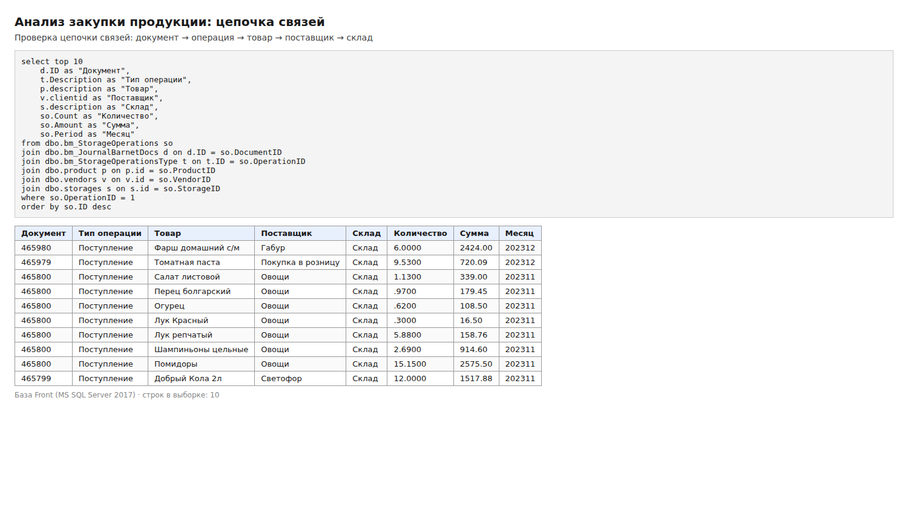

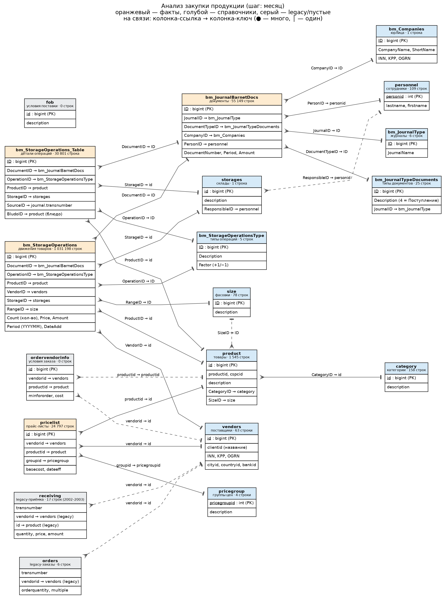

---

## 2. Продажа товара (шаг: месяц)

**основные:** journal, bm_Journal_Details
**связанные:** product, category, size, transtype, personnel, clients

**journal** — кассовый журнал, одна строка = одна операция чека (тут не только товары, но и оплата):

- transnumber — ключ строки, например `1675588`
- transtype — тип операции, `101` = продажа (PLU Sales)
- loginid — кассир, например `906`
- quantity, amount — количество и сумма, например `1.000`, `630.00`
- dater — дата операции

**bm_Journal_Details** — детали заказа, из каких товаров состоит блюдо:

- SourceID — строка журнала (transnumber)
- ProductID — товар, например `4407`
- BludoID — блюдо, например `4451`

**Как связаны:** деталь ссылается на строку журнала через SourceID = transnumber. Но детали есть **не у каждой строки** — только у товарных позиций. У оплаты и служебных операций деталей нет. Преподаватель проверяет это анти-джойном:

```sql
select
	count(*) as "Строк журнала",
	sum(case when t2.SourceID is not null then 1 else 0 end) as "С деталями",
	sum(case when t2.SourceID is null then 1 else 0 end) as "Без деталей"
from dbo.journal t1
left join (select SourceID from dbo.bm_Journal_Details group by SourceID) t2
	on t1.transnumber = t2.SourceID;

select
	tt.description as "Тип операции",
	count(*) as "Без деталей"
from dbo.journal t1
left join (select SourceID from dbo.bm_Journal_Details group by SourceID) t2
	on t1.transnumber = t2.SourceID
left join dbo.transtype tt on tt.transtypeid = t1.transtype
where t2.SourceID is null
group by tt.description
having count(*) > 500
order by "Без деталей" desc
```

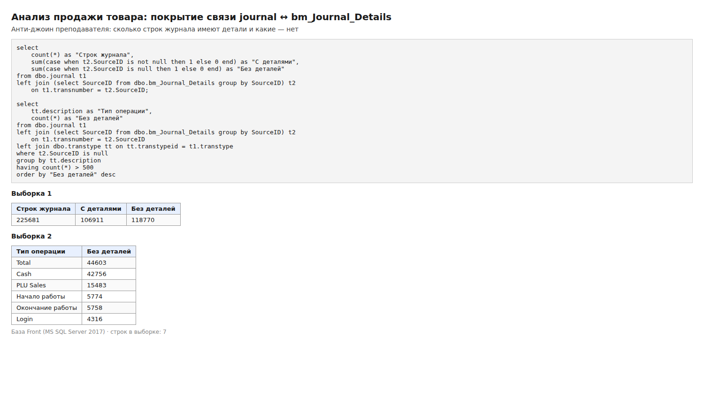

**У product есть еще связанные ключи.** Заполнены только CategoryID и SizeID (у всех 1 545 товаров), остальные (vendorid, pricegroupid, countryid, wineryid и др.) есть в структуре, но в данных пустые:

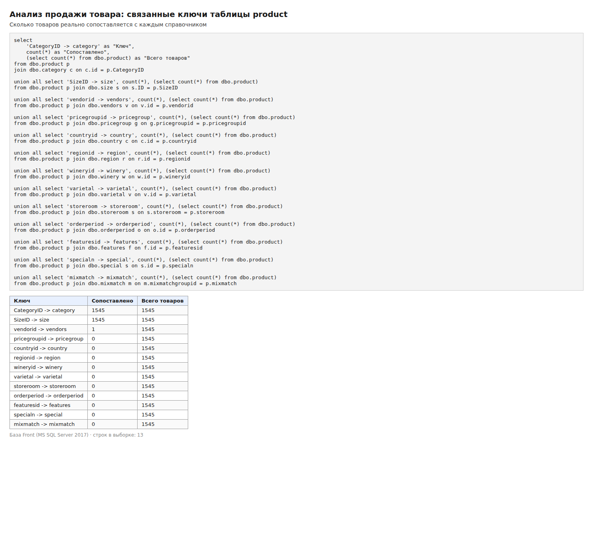

bm_JournalSessions (сессии системы) к продажам не относится — это персонал.

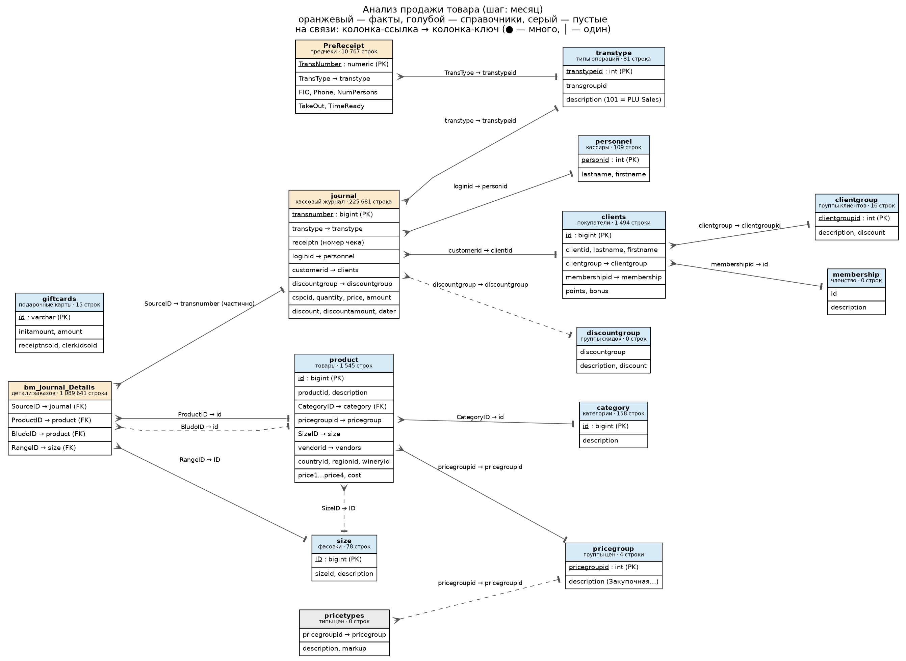

---

## 3. Взаимоотношения с поставщиками (шаг: месяц)

**основные:** vendors, pricelist
**связанные:** vendorgroup, city, country, bm_Companies, bm_Contracts, ordervendorinfo, bm_StorageOperations

**vendors** — карточка поставщика:

- id — ключ, например `200`
- clientid — название, например `ООО "Элит Трейд"`
- clientgroup — группа, например `31` («Поставщики»)
- cityid — город, например `8` (Ангарск)
- INN, KPP, OGRN — реквизиты

**pricelist** — прайс-листы: productid и groupid заполнены у всех строк, а vendorid пуст (NULL/0) — привязка прайса к поставщику не ведётся.

**bm_Companies** — юрлица-контрагенты (INN/KPP/OGRN). **bm_Contracts** (договоры) и **ordervendorinfo** (условия заказа) — пустые, структура есть.

**SQL: карточка поставщика**

```sql
select
	v.id as "Код",
	v.clientid as "Поставщик",
	vg.description as "Группа",
	ct.name as "Город",
	cn.name as "Страна",
	b.description as "Банк",
	v.INN as "ИНН"
from dbo.vendors v
left join dbo.vendorgroup vg on vg.vendorgroupid = v.clientgroup
left join dbo.city ct on ct.cityid = v.cityid
left join dbo.country cn on cn.id = v.countryid
left join dbo.banks b on b.id = v.bankid
order by v.id
```

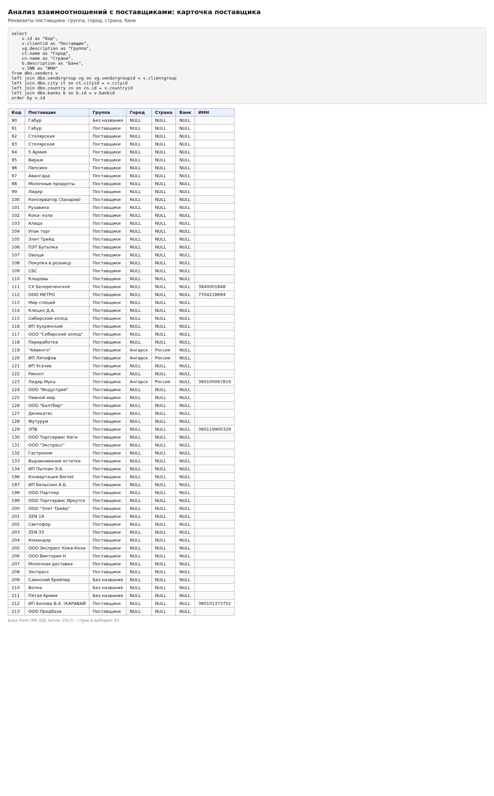

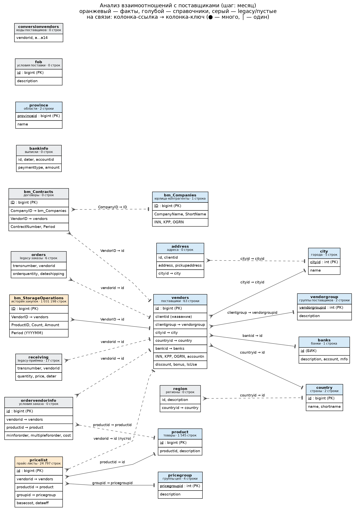

---

## 4. Работа персонала (шаг: полгода, квартал)

**основные:** personnel
**связанные:** journal, bm_JournalSessions, bm_JournalBarnetDocs, bm_BonusHistory, securityaccess

**personnel** — сотрудники, одна строка = один сотрудник:

- personid — ключ (он же логин кассира), например `906`
- lastname, firstname — фамилия и имя, например `Безик Татьяна`
- securityaccess — уровень доступа, например `9`
- flagpos, flagsales, flagrefunds — права (касса, продажи, возвраты)

**Как связаны:** у сотрудника много операций в journal (loginid = personid), много документов в bm_JournalBarnetDocs (PersonID), много сессий в bm_JournalSessions, бонусы в bm_BonusHistory. Все операции journal (225 681 строка) сопоставляются с сотрудником.

**SQL: документы сотрудника**

```sql
select top 10
	p.personid as "Таб. номер",
	p.lastname + ' ' + p.firstname as "Сотрудник",
	d.ID as "Документ",
	jt.JournalName as "Журнал",
	convert(varchar(19), d.Period, 120) as "Период",
	d.Amount as "Сумма"
from dbo.bm_JournalBarnetDocs d
join dbo.personnel p on p.personid = d.PersonID
left join dbo.bm_JournalType jt on jt.ID = d.JournalID
order by d.ID desc
```

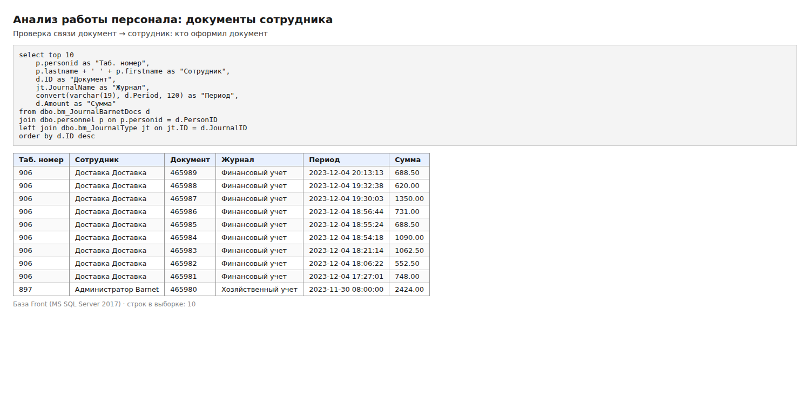

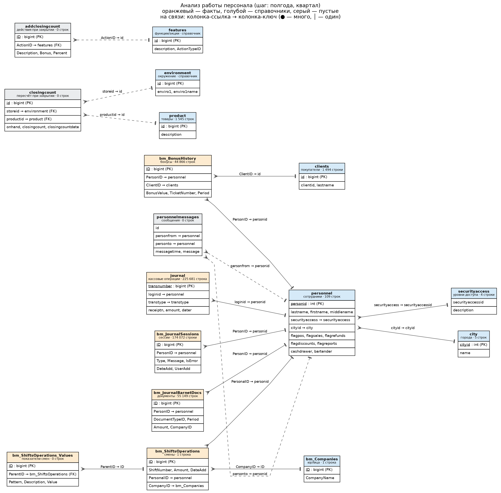

---

## 5. Остатки (шаг: одна неделя)

**основные:** bm_StorageOperations, bm_StorageOperations_Table
**связанные:** product, storages, bm_StorageOperationsType, bm_JournalBarnetDocs, beginperiod

Старые таблицы остатков (stock, onhand, storagesonhand, stockcounter, keg) пустые, поэтому остаток считаем из журнала движений bm_StorageOperations: Count с плюсом у поступлений, с минусом у списаний.

**SQL: остаток на конец недели 27.11.2023 – 03.12.2023**

```sql
select top 15
	p.description as "Товар",
	sum(so.Count) as "Остаток"
from dbo.bm_StorageOperations so
join dbo.product p on p.id = so.ProductID
where so.DateAdd <= '2023-12-03'
group by p.description
order by "Остаток" desc
```

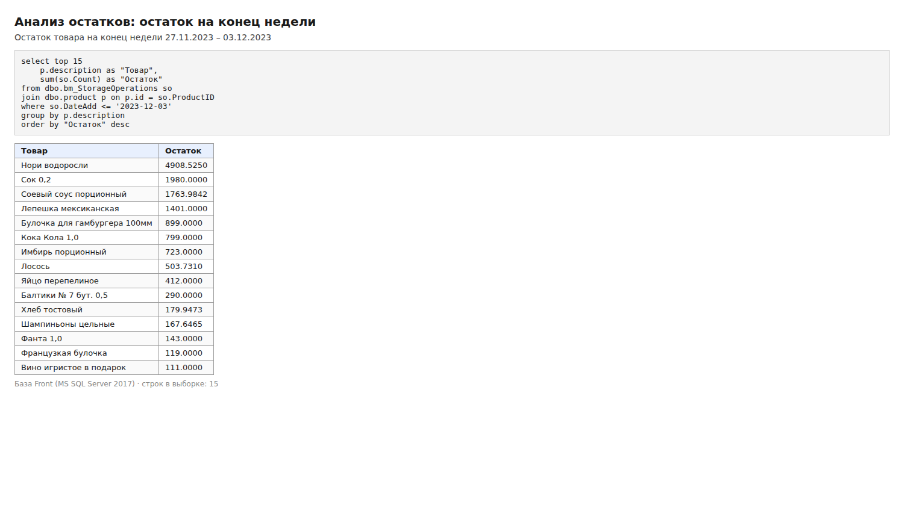

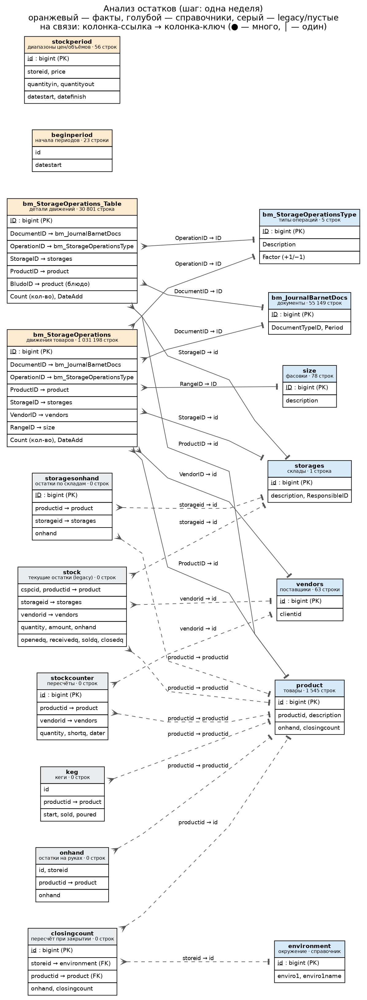

---

## Итог

| Направление | Данные | Основной источник |
|---|---|---|
| Закупки (месяц) | ✅ | bm_StorageOperations + bm_JournalBarnetDocs |
| Продажи (месяц) | ✅ | journal + bm_Journal_Details |
| Поставщики (месяц) | ✅ | vendors + история в bm_StorageOperations |
| Персонал (полгода/квартал) | ✅ | personnel + journal + bm_JournalBarnetDocs |
| Остатки (неделя) | ✅ | bm_StorageOperations.Count |
